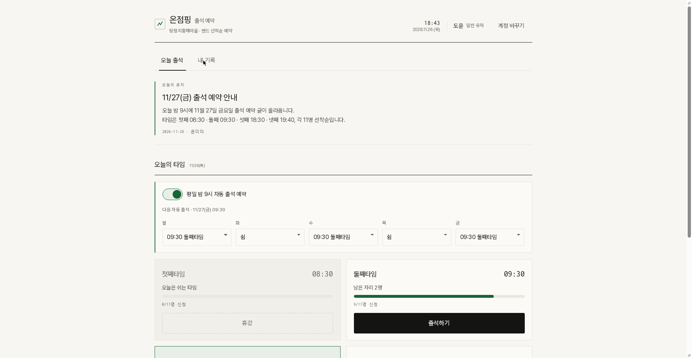
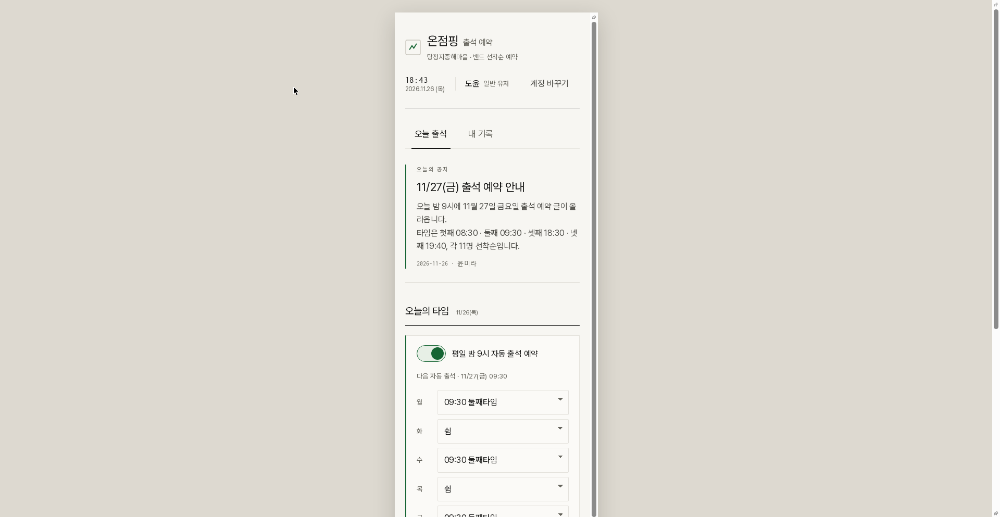
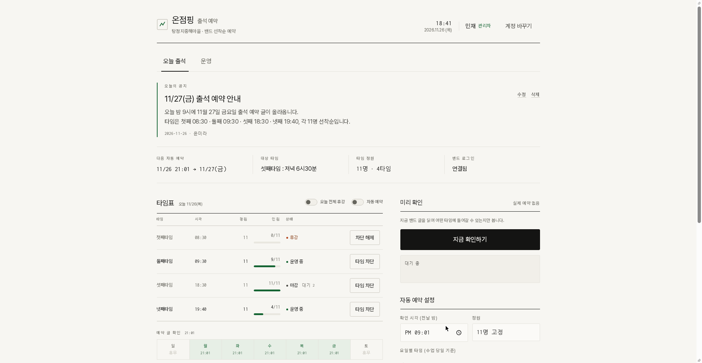

# 온점핑 출석 예약

탕정지중해마을 **On점핑** 네이버 밴드의 "다음 날 출석 예약" 글을 읽어, 정한 타임에
선착순으로 출석을 잡아 주는 도구입니다. 자동 예약은 Playwright 워커(`checker.py`)가 하고,
사람이 쓰는 화면은 파이썬 표준 라이브러리만으로 도는 대시보드(`server.py`)입니다.
같은 화면을 Vercel 서버리스(`api/index.py`)로도 올릴 수 있습니다.



## 무엇을 하나

| 구분 | 내용 |
|---|---|
| 자동 예약 | 정한 요일·타임을 전날 밤 `21:01`에 밴드에서 선착순으로 잡음 (요일별로 타임 지정, 쉼 선택) |
| 타임 | 첫째 `08:30` · 둘째 `09:30` · 셋째 `18:30` · 넷째 `19:40` (각 11명) |
| 역할 | **관리자**는 공지·유저·휴강·설정, **일반 유저**는 공지 확인과 자기 출석 |
| 출석 | 타임 카드에서 큰 버튼으로 출석/취소, 만석이면 대기 신청 |
| 휴강 | "오늘 전체 휴강" 또는 타임별 차단 — 막힌 타임은 출석 불가 |
| 공지 | "오늘의 공지" 등록·수정·삭제 (관리자), 모든 화면 상단에 노출 |
| 쉐이크 | 초코·바닐라·쿠키·딸기 중 1탭 찜, 관리자는 오늘 주문 목록 확인 |
| 기록 | 연속 출석(🔥), 월 달력, 최근 기록, 실행 로그 |
| 접근성 | 17px 기본 글자, 48~56px 버튼, "글씨 더 크게" 토글, 한글 위주 라벨 |
| 닉네임 | 각자 닉네임 설정, 관리자는 유저 목록에서 확인·수정 |

| 일반 유저 (모바일) | 관리자 |
|---|---|
|  |  |

## 설치

```bash
cd projects/onjumping-checkin
python -m venv .venv && source .venv/bin/activate    # Windows: .venv\Scripts\activate
pip install -r requirements.txt
playwright install chromium
```

## 1) 밴드 로그인 세션 (최초 1회)

```bash
python checker.py --setup-login
```

브라우저에서 네이버 밴드에 로그인한 뒤 터미널에서 Enter. `storage_state.json` 에 세션이
저장되며 `.gitignore` 에 들어 있습니다. **이 파일에는 로그인 쿠키가 있으니 공유·커밋 금지.**

## 2) 확인 · 실행

```bash
python checker.py --dry-run     # 어떤 글·타임에 들어갈 수 있는지만 확인
python checker.py               # 실제 투표
python checker.py --debug-dump  # 선택자 조정용 HTML 저장 (logs/debug/)
```

결과 상태: `voted` 예약 완료 · `dry` 확인만 · `already` 이미 참여 · `full` 마감 ·
`no_post`/`no_slot` 못 찾음 · `no_session` 로그인 필요 · `closed`/`slot_blocked` 휴강 ·
`day_off` 그 요일은 쉼 · `unverified` 제출 후 확인 실패.

## 3) 대시보드

```bash
python server.py            # http://127.0.0.1:8765
python server.py --port 9000
```

첫 실행에서 `data/app.db` 가 생기고 기본 계정이 들어갑니다.

- 관리자 **황보민재** (닉네임 `민재`, 삭제 불가)
- 일반 유저 **김도윤**(`도윤`), **이서연**(`서연`)

우측 상단 **계정 바꾸기**로 역할을 전환합니다. 로컬 전용이라 비밀번호 없이 사용자 id
쿠키로 구분하므로, 외부에 열지 말고 `127.0.0.1` 기본 바인딩을 유지하세요.

## 4) 요일별 자동 예약 규칙

- 설정: 요일(월~금)마다 `08:30 / 09:30 / 18:30 / 19:40` 중 하나 또는 `쉼`.
- 실행: **수업 전날 밤 `21:01`**. 화요일 수업은 월요일 21:01에 잡습니다.
- 주말(토·일)은 기본 `쉼` 입니다. 밴드에 주말 공지가 다시 올라오면 관리자 설정에서
  해당 요일을 켜면 됩니다.
- 관리자가 대시보드에서 바꾼 설정은 `config.json` 에 저장되어 `checker.py` 가 그대로 읽습니다.
  일반 유저의 요일 설정은 자기 계정(`users.weekly`)에 저장됩니다.

## 5) 정기 실행 (cron)

```cron
1 21 * * 0-4  cd /path/to/onjumping-checkin && .venv/bin/python checker.py >> logs/cron.log 2>&1
```

요일별 설정을 쓰므로 `checker.py` 가 해당 요일이 `쉼`이면 스스로 건너뜁니다.

## 6) Vercel 배포

웹 대시보드와 API만 Vercel 로 올릴 수 있습니다. 밴드 자동 예약(`checker.py`)은
Playwright 가 필요하므로 로컬이나 별도 워커에서 실행하세요.

```bash
npm i -g vercel      # 또는 npx vercel
cd projects/onjumping-checkin
vercel                # 미리보기 배포
vercel --prod         # 운영 배포
```

- `vercel.json` 이 모든 경로를 `api/index.py` 로 보내고, `static/**` 와 `config.json` 을
  함수 번들에 포함합니다.
- 서버리스에서는 파일시스템이 읽기 전용이라 DB 를 `/tmp/onjumping-data` 에 만듭니다.
  콜드 스타트마다 시드 데이터로 초기화되므로 데모·확인용으로 쓰고,
  실제 운영 데이터는 로컬 서버를 쓰세요.
- 서버리스에서는 설정 저장과 "미리 확인" 실행이 비활성화됩니다(응답 409 + 안내).

## API

세션 쿠키(`onjumping_uid`)로 사용자를 구분하고, 관리자 전용 요청은 일반 유저에게 `403`.

| Method | Path | 권한 | 설명 |
|---|---|---|---|
| POST | `/api/session` | — | `{user_id}` 로 로그인 |
| DELETE | `/api/session` | 로그인 | 로그아웃 |
| GET | `/api/bootstrap` | — | 화면 초기 데이터(역할별 필터) |
| GET | `/api/status` | 로그인 | 다음 실행·요일 설정·밴드 세션 상태 |
| GET/POST | `/api/config` | 관리자 | 예약 설정 조회·저장 |
| GET | `/api/day` · `/api/slots` | 로그인 | 날짜별 타임 상태·타임 목록 |
| POST | `/api/day` | 관리자 | 전체 휴강 `{closed_all}` / `{blocked:[...]}` |
| POST | `/api/day/slot` | 관리자 | 타임 하나 차단/해제 |
| POST | `/api/checkin` | 로그인 | 출석 `{date, slot_id}` |
| POST | `/api/checkin/cancel` | 로그인 | 출석 취소 |
| POST/DELETE | `/api/waitlist` | 로그인 | 만석 타임 대기 신청·취소 |
| POST | `/api/shake` | 로그인 | 쉐이크 맛 찜 `{flavor}` |
| POST | `/api/profile` | 로그인 | 닉네임·요일별 타임·자동 예약 on/off |
| GET/POST | `/api/users` | 관리자 | 유저 목록·추가 |
| PATCH/DELETE | `/api/users/{id}` | 관리자 | 유저 수정·삭제 |
| GET/POST | `/api/notices` | 로그인/관리자 | 공지 목록·등록 |
| PATCH/DELETE | `/api/notices/{id}` | 관리자 | 공지 수정·삭제 |
| POST | `/api/run-dry` | 관리자 | 로컬 dry-run 시작 (`job_id`) |
| GET | `/api/run-dry/{id}` | 로그인 | 작업 상태·출력 |

## 코드 구조

```
checker.py            Playwright 밴드 예약 (--setup-login / --dry-run / --debug-dump)
app_core.py           플랫폼 독립 라우팅 (로컬 서버와 Vercel 이 공유)
server.py             로컬 http.server + 정적 파일
api/index.py          Vercel WSGI 진입점 (/tmp 저장소 사용)
store.py              SQLite: users · notices · checkins · day_controls · slot_blocks · waitlist · shakes
static/               대시보드 (index.html · style.css · app.js)
tools/make_preview.py 샘플 데이터 단일 파일 미리보기 생성
tools/visual_qa.py    로컬 서버 + 스크린샷 캡처
tests/test_api.py     API 13개 시나리오 (python -m unittest tests.test_api)
docs/preview.html     서버 없이 보는 디자인 미리보기
```

## 화면 미리보기 (샘플 데이터)

- 일반 유저: `docs/preview.html`
- 관리자: `docs/preview-admin.html`
- 모바일 폭: `docs/preview-mobile.html`

## 주의

- 네이버 밴드는 공개 API가 없습니다. 화면 구조가 바뀌면 `checker.py` 의
  `find_target_post` / `find_slot_option` 을 조정하고 `--debug-dump` 로 확인하세요.
- 정원이 찼거나 글이 없으면 투표하지 않고 기록만 남깁니다.
- 본인 계정으로 본인 출석을 잡는 용도입니다. 계정 공유·대리 예약에는 쓰지 마세요.

---

## English

A small tool for the **On점핑** Naver Band attendance poll: `checker.py` reads the
next-day post with Playwright and votes for the configured slot (first 08:30, second
09:30, third 18:30, fourth 19:40 — 11 spots each). The dashboard (`server.py`) offers an
admin role (members, notices, full/partial holiday blocks, schedule) and a member role
(simple large cards, check-in/cancel, waitlist, daily shake pick, streak & calendar).

```bash
pip install -r requirements.txt && playwright install chromium
python checker.py --setup-login
python checker.py --dry-run
python server.py        # http://127.0.0.1:8765
vercel                  # dashboard + API on Vercel (checker stays local)
```

Cookie-based auth is for localhost use only. `storage_state.json`, `data/app.db` and
`logs/history.json` stay out of git.
