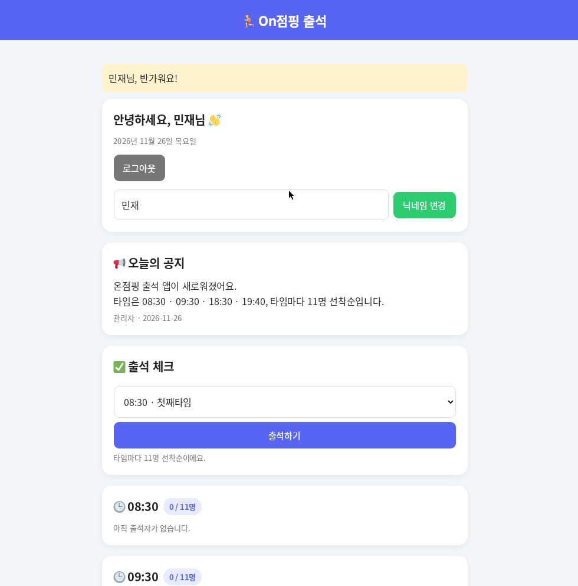
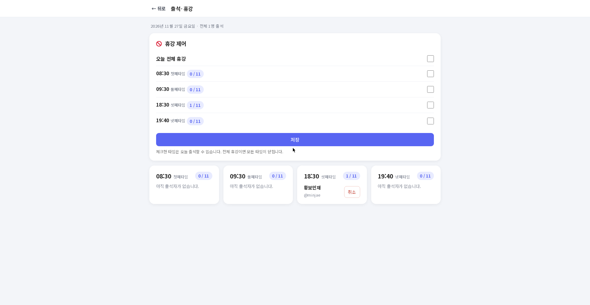

# On점핑 출석

탕정지중해마을 **On점핑** 출석을 한 화면에서 관리하는 작은 앱입니다. 카드 한 줄짜리
모바일 화면에 로그인 → 오늘 출석 → 시간별 명단 → 평일 자동 출석만 남겼습니다.
파이썬 표준 라이브러리만으로 돌아가고, Vercel 서버리스에도 그대로 올라갑니다.

- 라이브: **https://onjumping.vercel.app**
- 저장소: https://github.com/minjaedev15/onjumping-checkin

| 오늘 출석 | 관리자 |
|---|---|
|  |  |

## 계정

| 아이디 | 비밀번호 | 역할 |
|---|---|---|
| `admin` | `admin1234` | 관리자 (공지 · 휴강 · 회원 관리) |
| `minjae` | `1234` | 회원 (테스트용) |
| `doyun` | `1234` | 회원 (테스트용) |

비밀번호는 PBKDF2-SHA256 해시로 저장하고, 로그인 상태는 서명된
`onjumping_uid` 쿠키(30일)로 유지합니다. **배포 후에는 `admin` 비밀번호를
바꾸고 테스트 계정을 지우세요.** (아래 "운영 메모" 참고)

## 화면

### 오늘 출석 `/`
- 인사 카드: `안녕하세요, ○○님 👋`, 오늘 날짜, 닉네임 즉시 변경, 로그아웃 · 관리자 버튼
- 오늘의 공지 (있을 때만), `오늘 전체 휴강` 이면 빨간 배너
- 출석 체크: `08:30 · 09:30 · 18:30 · 19:40` 중 하나 (`(휴강)` · `(마감)` · `(출석함)` 은 선택 불가)
- 시간별 명단: `🕒 18:30 · 3 / 11명` 배지, 내 출석(또는 관리자)은 `취소`
- 평일 자동 출석: 월~금 각각 `쉼 / 08:30 / 09:30 / 18:30 / 19:40` 저장 (주말 없음)

### 관리자 `/admin`
- 오늘의 공지 등록 · 삭제 (하루 한 건, 다시 등록하면 내용만 바뀜)
- 휴강: `오늘 전체 휴강` 체크 또는 타임별 체크 후 저장
- 회원 생성 · 회원 목록(관리자는 `👑 관리자` 배지, 삭제 불가)

## 로컬 실행

```bash
cd projects/onjumping-checkin
python server.py                 # http://127.0.0.1:8765
python server.py --port 9000
```

첫 실행에서 `data/onjumping.db` 가 생기고 위 계정이 들어갑니다.
외부에 열지 않으려면 기본 바인딩(`127.0.0.1`)을 그대로 두세요.

## 밴드 자동 예약 (`checker.py`)

네이버 밴드의 "다음 날 출석 예약" 글에 Playwright 로 투표합니다.

```bash
pip install -r requirements.txt && playwright install chromium
python checker.py --setup-login   # 최초 1회, 브라우저에서 밴드 로그인
python checker.py --dry-run       # 실제 투표 없이 확인
python checker.py                 # 실제 투표
```

- 실행 시각은 `config.json` 의 `schedule.at`(기본 21:01), 대상 날짜는 `days_ahead`(기본 1).
- **어느 요일에 어느 타임을 잡을지는 화면의 "평일 자동 출석" 설정을 따릅니다.**
  `config.json` 에 `user_id`(기본 1 = `admin`) 계정의 요일 설정을 읽고, 그 요일이
  `쉼` 이면 투표하지 않습니다. (`config.json` 의 옛 `schedule.weekly` 는 계정이 없을 때만 쓰는 대체값)
- 결과 상태: `voted` · `dry` · `already` · `full` · `no_post` · `no_slot` · `no_session` ·
  `closed` · `slot_blocked` · `day_off` · `unverified`

```cron
1 21 * * 0-4  cd /path/to/onjumping-checkin && .venv/bin/python checker.py >> logs/cron.log 2>&1
```

`storage_state.json` 에는 밴드 로그인 쿠키가 들어 있습니다. `.gitignore` 에 있고 절대 공유하지 마세요.

## Vercel 배포

`vercel.json` 이 모든 경로를 `api/index.py`(WSGI)로 보냅니다.

```bash
vercel --prod
```

### 운영 메모 (꼭 읽기)
- 서버리스는 `/tmp` 에만 쓸 수 있어서 **콜드 스타트마다 DB 가 시드 상태로 돌아갑니다.**
  즉 Vercel 에서 만든 회원·공지·출석 기록은 인스턴스가 식으면 사라집니다.
  실제 운영 데이터는 로컬 서버(또는 상시 실행 서버)를 쓰고, Vercel 은 화면 확인·공유용으로 보세요.
- 세션 서명 키는 DB 의 `settings` 에 만들어 두므로, 위 이유로 콜드 스타트에서 함께 초기화됩니다
  (그때는 다시 로그인하면 됩니다).
- 밴드 자동 예약(`checker.py`)은 Playwright 가 필요해 Vercel 에서 돌지 않습니다. 로컬/cron 에서 실행하세요.

## 코드 구조

```
webapp.py        WSGI 앱: 라우팅 · 화면(HTML/CSS) · 로그인 세션
store.py         SQLite: users · attendance · notices · day_controls · slot_blocks
server.py        로컬 서버 (wsgiref)
api/index.py     Vercel 서버리스 진입점 (/tmp 저장소)
checker.py       Playwright 밴드 자동 예약 워커
config.json      자동 예약 설정 (실행 시각 · 대상 날짜 · 밴드 주소)
tests/           test_api.py(화면·권한·출석·휴강·회원) · test_checker.py(파싱)
tools/visual_qa.py  로컬 화면 캡처 (개발용)
```

## 테스트

```bash
python -m unittest discover tests -v
```

## 주의

- 네이버 밴드는 공개 API가 없습니다. 화면 구조가 바뀌면 `checker.py` 의
  `find_target_post` / `find_slot_option` 을 조정하고 `--debug-dump` 로 확인하세요.
- 정원이 찼거나 글이 없으면 투표하지 않고 기록만 남깁니다.
- 본인 계정으로 본인 출석을 잡는 용도입니다. 계정 공유·대리 예약에는 쓰지 마세요.
