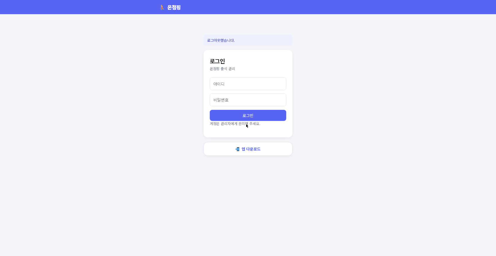

# On점핑 출석

탕정지중해마을 **On점핑** 출석을 밴드 대신 처리하는 작은 웹앱입니다.
파이썬 표준 라이브러리만으로 돌아가고, Vercel 서버리스에 그대로 올라가며,
데이터는 Upstash Redis(Vercel Storage)에 영구 저장됩니다.

- 라이브: **https://onjumping.vercel.app**
- 저장소: https://github.com/minjaedev15/onjumping-checkin

| 로그인 | 회원 · 오늘 출석 | 관리자 · 출석/휴강 |
|---|---|---|
|  |  |  |

## 화면

| 경로 | 누구나 | 내용 |
|---|---|---|
| `/login` | — | 아이디·비밀번호 로그인 (힌트·테스트 계정 안내 없음) |
| `/` | 회원 | 오늘 날짜, 4개 타임(08:30 · 09:30 · 18:30 · 19:40) 출석/취소와 타임별 현황, 오늘의 공지 요약 |
| `/notices` | 회원 | 오늘의 공지 + 지난 공지 목록 |
| `/auto` | 회원 | 평일(월~금) 자동 출석 타임 설정, 닉네임 변경 |
| `/admin` | 관리자 | 오늘 타임별 출석 명단(취소 포함), 전체/타임별 휴강 제어 |
| `/admin/notices` | 관리자 | 공지 등록·수정·삭제 |
| `/admin/users` | 관리자 | 회원 생성·목록·삭제 |

관리자로 로그인하면 상단 탭에 `출석·휴강 · 공지 관리 · 회원`이 함께 나옵니다.

## 계정과 비밀번호

- 관리자 아이디는 **`admin`** 이고, 비밀번호는 **서버 환경변수로만** 검증합니다.
  저장소(DB)에는 관리자 비밀번호 해시조차 남기지 않습니다.
- 관리자 비밀번호는 Vercel 프로젝트 환경변수 `ADMIN_PASSWORD`(또는 PBKDF2 해시를
  넣는 `ADMIN_PASSWORD_HASH`)로 설정합니다. 코드·HTML·README·로그인 화면 어디에도
  비밀번호를 적지 않습니다.
- 세션 쿠키 서명 키는 `SESSION_SECRET` 환경변수를 씁니다(없으면 저장소에 한 번 만들어 둡니다).
- 일반 회원은 관리자 화면의 `회원` 탭에서 만들고, 비밀번호는 PBKDF2-SHA256 해시로 저장합니다.
- 로그인 상태는 서명된 `onjumping_uid` 쿠키(30일, HttpOnly, SameSite=Lax)로 유지합니다.

### 필요한 환경변수

| 이름 | 설명 |
|---|---|
| `ADMIN_PASSWORD` | 관리자 `admin` 비밀번호 (서버에서만 비교) |
| `SESSION_SECRET` | 세션 쿠키 서명 키 (임의의 긴 문자열) |
| `KV_REST_API_URL` | Upstash Redis REST 주소 — Vercel Storage 연결 시 자동 주입 |
| `KV_REST_API_TOKEN` | Upstash Redis REST 토큰 — Vercel Storage 연결 시 자동 주입 |

`UPSTASH_REDIS_REST_URL` / `UPSTASH_REDIS_REST_TOKEN` 이름도 인식합니다.
`KV_*` 가 없으면 SQLite(`data/onjumping.db`)로 떨어지므로 로컬 개발은 그대로 됩니다.

## 저장소

```
store.py
  ├─ _RedisBackend   Upstash Redis REST (urllib 만 사용, POST 명령)
  ├─ _SqliteBackend  로컬 SQLite (state 테이블 한 행에 JSON)
  └─ 앱 로직         users · attendance · notices · day_controls · slot_blocks

앱 상태 전체가 하나의 JSON 문서(state key: onjumping:state:v1)이고,
저장은 "읽은 원문과 지금 저장된 값이 같을 때만" 반영하는 CAS(compare-and-set)입니다.
동시에 두 요청이 고치면 한쪽만 반영되고, 다른 쪽은 최신 문서로 같은 변경을 다시 적용합니다.
```

## 로컬 실행

```bash
cd projects/onjumping-checkin
ADMIN_PASSWORD=원하는비번 SESSION_SECRET=아무긴문자열 python server.py   # http://127.0.0.1:8765
```

- 첫 실행에서 `data/onjumping.db` 가 생기고 관리자 계정(`admin`)이 만들어집니다.
- `ADMIN_PASSWORD` 를 주지 않으면 임시 비밀번호를 만들어 터미널에 한 번 출력합니다.
- 외부에 열지 않으려면 기본 바인딩(`127.0.0.1`)을 그대로 두세요.

## 테스트

```bash
python -m unittest discover tests -v
```

- `tests/test_api.py` — 로그인, 권한, 화면 분리, 출석/취소, 휴강, 공지, 회원 관리
- `tests/test_store.py` — 문서 저장·재조회, CAS 재시도, (환경변수가 있으면) 실제 Upstash
- `tests/test_checker.py` — 밴드 글 파싱

원격 저장소까지 확인하려면:

```bash
KV_REST_API_URL=... KV_REST_API_TOKEN=... ONJUMPING_TEST_REMOTE=1 \
  ONJUMPING_STATE_KEY=onjumping:test:$(date +%s) python -m unittest tests.test_api
```

## 밴드 자동 예약 (`checker.py`)

네이버 밴드의 "다음 날 출석 예약" 글에 Playwright 로 투표합니다.

```bash
pip install -r requirements.txt && playwright install chromium
python checker.py --setup-login   # 최초 1회, 브라우저에서 밴드 로그인
python checker.py --dry-run       # 실제 투표 없이 확인
python checker.py                 # 실제 투표
```

- 실행 시각은 `config.json` 의 `schedule.at`(기본 21:01), 대상 날짜는 `days_ahead`(기본 1).
- 어느 요일에 어느 타임을 잡을지는 화면 `/auto` 의 "평일 자동 출석" 설정을 따릅니다.
  `config.json` 의 `user_id`(기본 1 = `admin`) 계정의 요일 설정을 읽고, 그 요일이
  `쉼` 이면 투표하지 않습니다.
- 결과 상태: `voted` · `dry` · `already` · `full` · `no_post` · `no_slot` · `no_session` ·
  `closed` · `slot_blocked` · `day_off` · `unverified`

```cron
1 21 * * 0-4  cd /path/to/onjumping-checkin && .venv/bin/python checker.py >> logs/cron.log 2>&1
```

`storage_state.json` 에는 밴드 로그인 쿠키가 들어 있습니다. `.gitignore` 에 있고 절대 공유하지 마세요.
`checker.py` 는 Playwright 가 필요해 Vercel 함수에서는 돌지 않습니다. 로컬/cron 에서 실행하세요.

## Vercel 배포

`vercel.json` 이 모든 경로를 `api/index.py`(WSGI)로 보냅니다. `main` 브랜치에 푸시하면
프로덕션 배포가 됩니다.

```bash
vercel --prod   # 또는 GitHub main 푸시
```

## 코드 구조

```
webapp.py        WSGI 앱: 라우팅 · 페이지별 화면(HTML/CSS) · 로그인 세션
store.py         저장소(Upstash Redis REST / SQLite) + 앱 데이터 로직
server.py        로컬 서버 (wsgiref)
api/index.py     Vercel 서버리스 진입점
checker.py       Playwright 밴드 자동 예약 워커
config.json      자동 예약 설정 (실행 시각 · 대상 날짜 · 밴드 주소)
tests/           test_api.py · test_store.py · test_checker.py
tools/visual_qa.py  로컬 화면 캡처 (개발용, 비밀번호는 환경변수)
```

## 주의

- 네이버 밴드는 공개 API가 없습니다. 화면 구조가 바뀌면 `checker.py` 의
  `find_target_post` / `find_slot_option` 을 조정하고 `--debug-dump` 로 확인하세요.
- 정원이 찼거나 글이 없으면 투표하지 않고 기록만 남깁니다.
- 본인 계정으로 본인 출석을 잡는 용도입니다. 계정 공유·대리 예약에는 쓰지 마세요.
